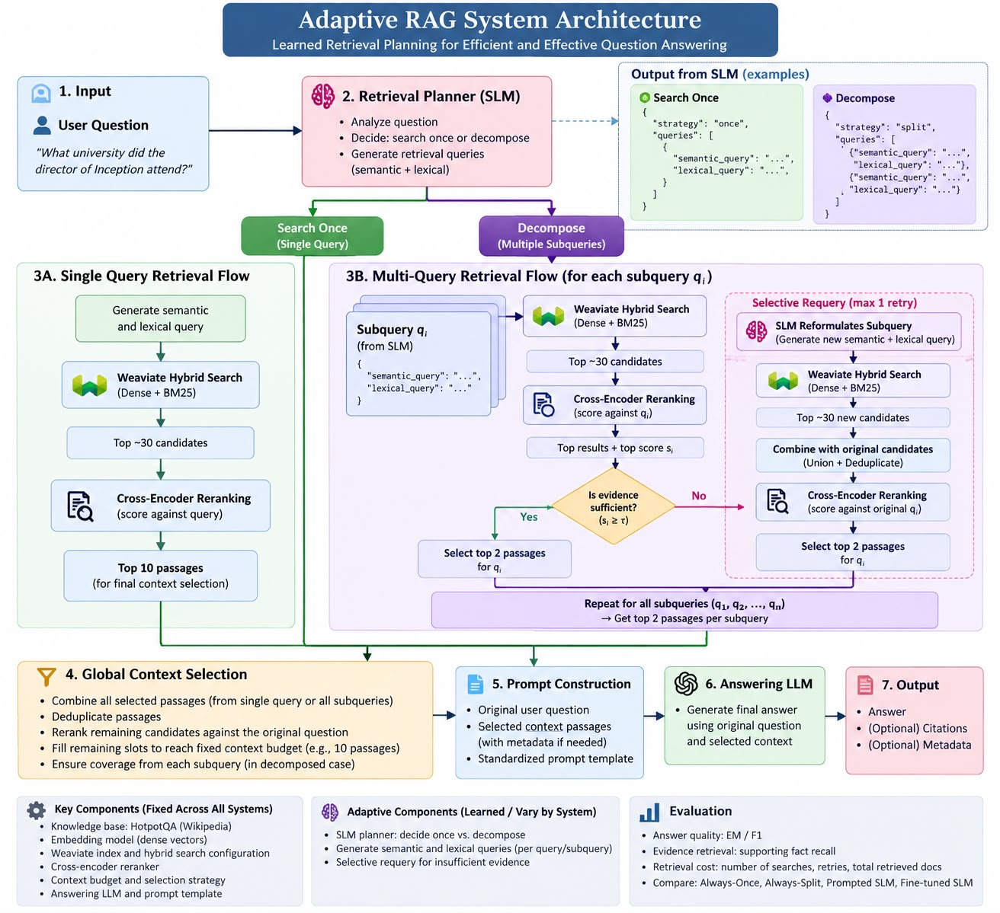

# Adaptive RAG

Adaptive RAG evaluates when a question benefits from two retrieval queries instead of one. The planner writes lexical and semantic queries. Weaviate runs hybrid search, a cross-encoder reranks the passages, and a small language model answers from the selected context. If the top passage scores below the relevance threshold, the retriever rewrites the query and searches again.

The learned planner trains on teacher-generated plans. Both plans are evaluated against the same gold passages. A split plan becomes the training target when its retrieval score improves enough to clear a configurable threshold.



## Run a baseline

Use Python 3.11 or newer and an API-key-authenticated Weaviate instance reachable over both HTTP and gRPC. The first run downloads datasets and model weights from Hugging Face. A GPU is recommended for embedding the corpus and running the language model.

1. From the repository root, install the package in your Python environment.

   ```sh
   python -m pip install -e .
   ```

2. Use [.env.example](.env.example) to configure `.env`. Both hostnames and the API key are required. Set the HTTP and gRPC ports and TLS flags to match your instance. Omitted ports default to 443 and omitted TLS flags default to true. Host values contain only the hostname. The package loads `.env` at import time and gives existing environment variables precedence. Keep `.env` out of version control.

3. Use a dedicated Weaviate instance or an empty `AdaptiveRag` collection. Ingestion can replace an existing collection whose object count differs from the corpus size. Prepare a balanced 50-question validation subset, then index the full shared HotpotQA and SQuAD corpus. The subset limits the evaluation size only.

   ```sh
   python -c "from adaptive_rag.data.prepare_data import prepare_subsets; prepare_subsets({'val': {'n': 50, 'strategy': 'balanced'}})"
   python -c "from adaptive_rag.database.ingestion import ingest_data; ingest_data()"
   ```

4. Run the single-query baseline.

   ```sh
   python -c "from adaptive_rag.config import VAL_SUBSET_PATH; from adaptive_rag.evaluation.runner import run_evaluation; run_evaluation('baseline_once', VAL_SUBSET_PATH, 'always_once', sampling_strategy='balanced')"
   ```

The run saves its checkpoint under `results/baseline_once/` and writes `config.json`, `results.csv`, `results.parquet`, and `summary.json` when complete. To resume an interruption, run the same evaluation command with the same inputs and settings. New checkpoints store a fingerprint of the Weaviate endpoints. Use a new experiment ID for a different configuration or for a legacy run whose checkpoint predates endpoint fingerprints.

## Train and evaluate the learned planner

1. [Prepare training data](notebooks/01_prepare_training_data.ipynb). Set `OPENAI_API_KEY` and `OPENAI_TEACHER_MODEL` for teacher generation. Use the populated Weaviate index to score both plans, then export `planner_train.jsonl`. Teacher generation uses the OpenAI API. The retrieval stage runs embedding, reranking, and rewriting models locally, where a GPU is recommended.
2. [Train the planner](notebooks/02_train_planner.ipynb). Install the training extra with `python -m pip install -e ".[training]"` for a local checkout, or use the notebook's Colab setup. Point it at `planner_train.jsonl`. The default 4-bit QLoRA setup requires a CUDA GPU and saves a PEFT adapter and tokenizer.
3. [Evaluate the planner](notebooks/03_evaluate_planner.ipynb). The notebook expects a CUDA GPU, access to the populated Weaviate index, the held-out `test_subset.parquet`, and an adapter for fine-tuned modes. It compares three base-model conditions with three adapter conditions using the same test questions.

## Checked-in baseline results

Each run used the same 50 validation questions, balanced between HotpotQA and SQuAD.

| Planner | Recall@7 | Answer F1 | Mean search calls |
| --- | ---: | ---: | ---: |
| [Always once](results/always_once_val_001/summary.json) | 0.760 | 0.533 | 1.16 |
| [Always split](results/always_split_val_001/summary.json) | 0.750 | 0.538 | 2.44 |
| [Prompted adaptive](results/prompted_val_001/summary.json) | 0.720 | 0.474 | 1.30 |

On this sample, always once had the highest recall and used the fewest search calls. Always split had slightly higher answer F1. These runs provide reference points for evaluating the fine-tuned planner.

## Tests

```sh
python -m pip install -e ".[dev]"
python -m pytest
```
